<p align="center">
  
</p>

**AutoTapper** 是一个 Android 自动化工具：**规则 = 一串步骤**，每一步可以是「点一下」，也可以是插件提供的「长按 / 连击 / 滑动 / 多指 / 识色 / 识字 / 数字对比 / 识 ID / 计时 / 计数 / 录音回放……」。
点击由 **无障碍手势** 或 **Shizuku** 执行，二选一；控制器、点位徽标和当前进度都浮在被控应用之上。

> 版本 **1.4.0**：基础点击变成了「规则 + 步骤」，功能改由插件提供，仓库索引支持 **jsDelivr 镜像**（国内可直连）。

## 先看效果

<p align="center">
  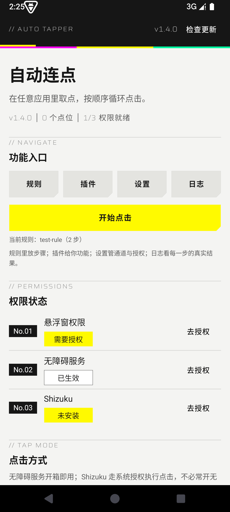
  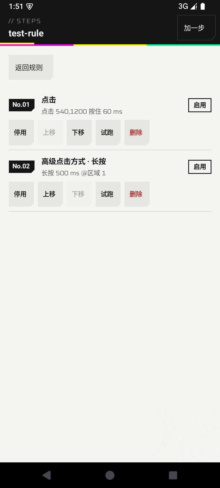
  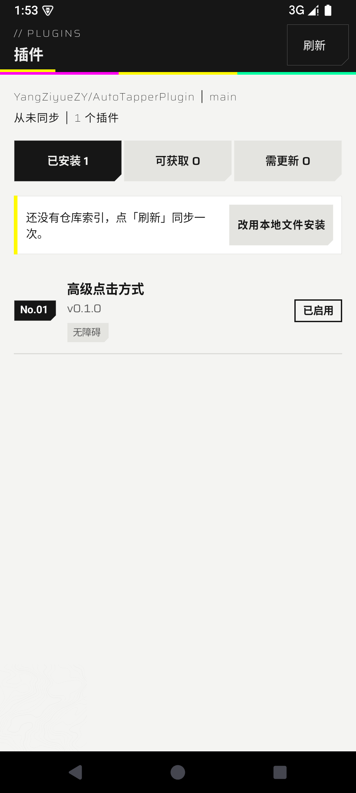
</p>
<p align="center">
  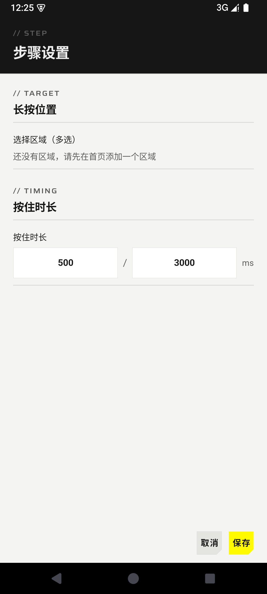
  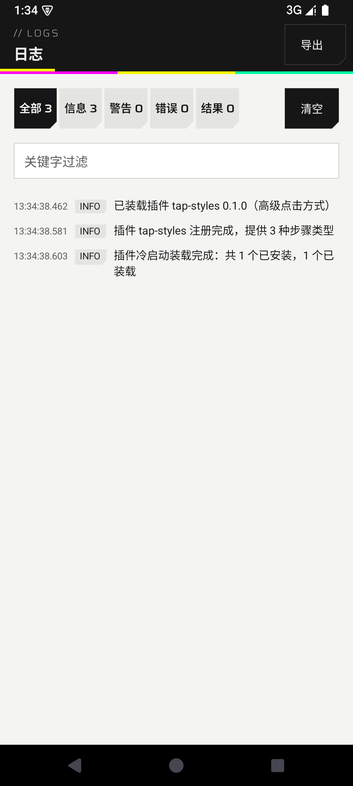
  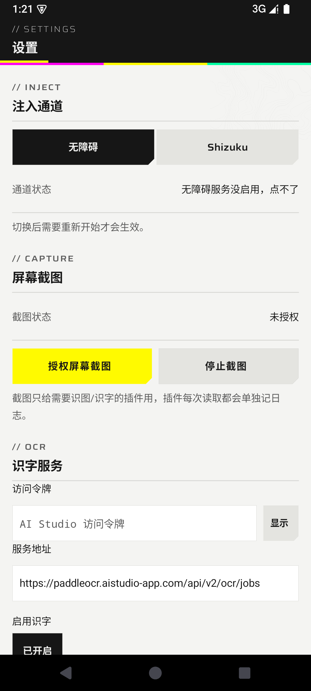
</p>
<p align="center">
  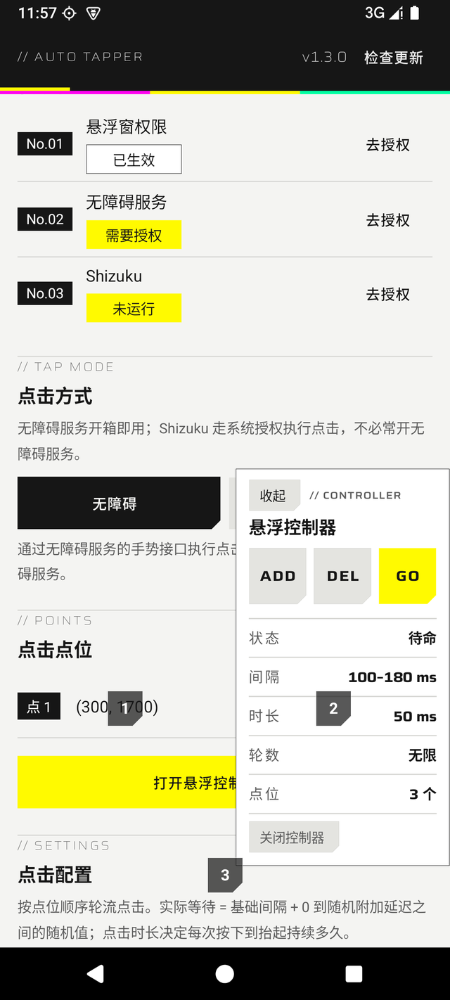
  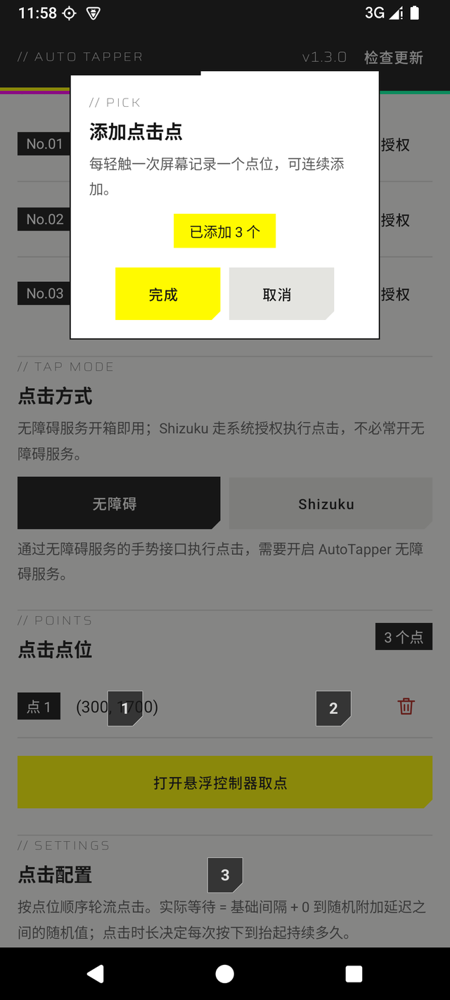
  
</p>

## 它解决什么

- **规则 + 步骤**：一条规则是一串步骤，每步可以启用/停用/上下移动/单步试跑；旧版本的点位配置在首次启动时自动迁移成一条规则，参数原样保留。
- **功能靠插件**：主程序只留基础点击与宿主能力（截图、识字、注入、区域、时间、日志）。17 个插件、22 个步骤类型按需安装，装完立刻出现在「加一步」里。
- **两种注入通道**：无障碍服务开箱即用；Shizuku 授权后由系统 shell 注入，不必常开无障碍服务。
- **控制器常驻**：收起是一枚 40×54dp 的贴边小标签，展开是一条 46dp 宽的窄条，取点、开始、停止都不离开被控应用。
- **国内能装上插件**：索引默认走 **jsDelivr 镜像**，也可以在设置里换成你自己的镜像地址；镜像不通会自动回退官方直连。

## 怎么用

1. 到 [Releases](https://github.com/YangZiyueZY/AutoTapper/releases/latest) 下载 APK 安装（Android 8.0 / API 26 及以上）。
2. 在主界面「权限状态」里完成授权：**悬浮窗**（控制器要用）、以及 **无障碍** 或 **Shizuku** 二选一。
3. 点「规则」→「新建」，进到步骤流程 →「加一步」：
   - **基础点击**：填 X / Y 与按住时长；
   - **插件步骤**：选一个插件能力，宿主会按插件声明的字段画表单，填完保存。
4. 回主界面按「开始点击」。运行中按钮变成「停止点击」，状态与每一步结果都会进「日志」。
5. 想要更多能力，进「插件」面板从仓库安装（或从本地 jar 安装）。

> 授权不会让它自动点击：只有按「开始点击」或悬浮控制器上的「开始」时才会执行。

## 规则与步骤

- **规则列表**：新建 / 重命名 / 复制 / 删除（进回收站，最多 30 条）/ 设为当前。
- **步骤流程**：编号、类型、一行摘要、启用开关、上移下移、删除、**单步试跑**。
  插件步骤缺插件时显示「缺插件」而不是崩。
- **参数**：间隔、随机附加延迟、点击轮数仍然在「点击配置」里调；每个步骤自己的参数在步骤编辑器里。
- **打点**：悬浮控制器上的「取点」仍然可用，取到的点位可以直接当作基础点击步骤的坐标。

## 插件

- 插件与主程序**同进程同权限**，安装页会原样提示：「插件与主程序拥有相同权限，请只安装你信任来源的插件。」
- 每道校验都不跳过：固定仓库地址 → `index.json` 里的 `sha256` →（配了公钥时）`SHA256withRSA` 分离签名。
  宿主没配公钥时列表如实标「未校验」，不假装已验签。
- 能力声明会写在卡片上：截图 / 联网 / 无障碍 / Shizuku / 悬浮窗。
- 插件不画界面：它只声明要哪些字段（文本、整数、区间、开关、枚举、区域、颜色、列表、步骤序号），
  宿主用终末地风味的部件渲染，所以 20 个插件的界面风格是一致的。
- 卸载会一并清掉插件文件与该插件的私有配置；已经写进规则的插件步骤会显示「缺插件」，不会让主程序崩。

### 镜像（国内加速）

设置页「插件仓库」里可以选：

| 选项 | 说明 |
| --- | --- |
| 官方直连 | `raw.githubusercontent.com`（默认回退项） |
| jsDelivr 镜像 | `cdn.jsdelivr.net/gh/{owner}/{repo}@{branch}`，**默认镜像** |
| 自定义 | 填模板，必须含 `{owner}` `{repo}` `{branch}` 三个占位符，例如 `https://ghproxy.net/https://raw.githubusercontent.com/{owner}/{repo}/{branch}` |

<p align="center">
  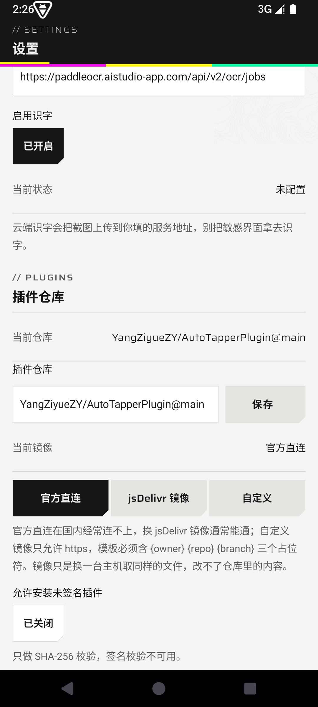
</p>

- 保存后会立即登记该域名为可信来源并重新同步一次；不是 https、端口不是 443、带用户名密码的地址一律拒绝。
- 镜像请求失败时**自动回退官方直连**再试一次，两条日志都会写进「日志」页，用户能看见发生了什么。

> **实测结论（2026-11-22）**：jsDelivr 三个节点都会正常返回 `index.json`、`README.md`，
> 但对 `.jar` 一律返回 **403**。所以宿主里 `Mirror.servesBinary` 对 jsDelivr 是 `false`——
> 索引走镜像，**插件包与签名直接走官方直连**，不会白撞一次 403。
> 如果你的网络连 `raw.githubusercontent.com` 也不通，把镜像换成自定义模板，指向一个 raw 代理
> （上面 ghproxy 那行就是例子），索引与 jar 就都能下来。

## 设置与日志

- **设置**：注入通道、屏幕截图授权、识字服务（令牌 / 服务地址 / 启用）、插件仓库与镜像、
  允许未签名插件、用北京时间校准、日志目录与清空。
- **日志**：实时追加，按「全部 / 信息 / 警告 / 错误 / 结果」筛选（计数是真数），关键字过滤，
  上滑超过两屏自动暂停滚动，可以导出成文件。
- 每一步的结果都会落一行：`步骤 3 成功，用时 42 ms` / `步骤 4 失败：没找到节点「确定」`。

## 平板适配

<p align="center">
  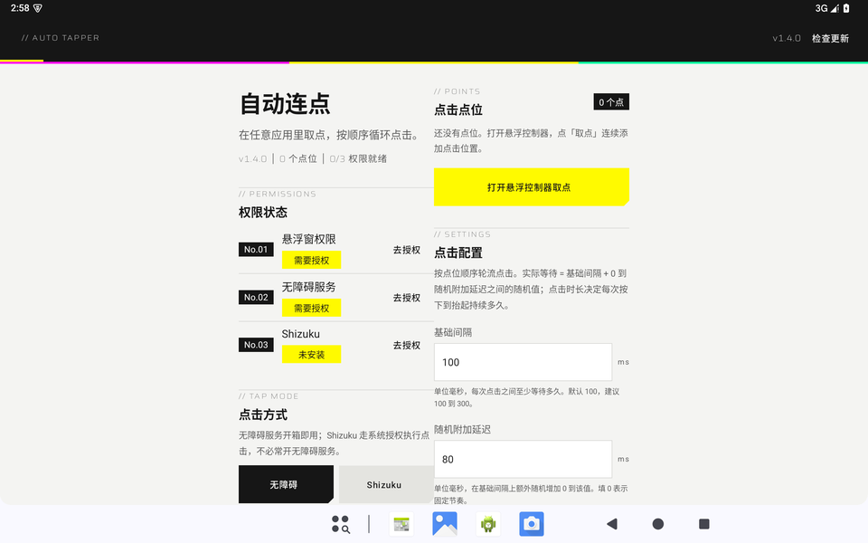
  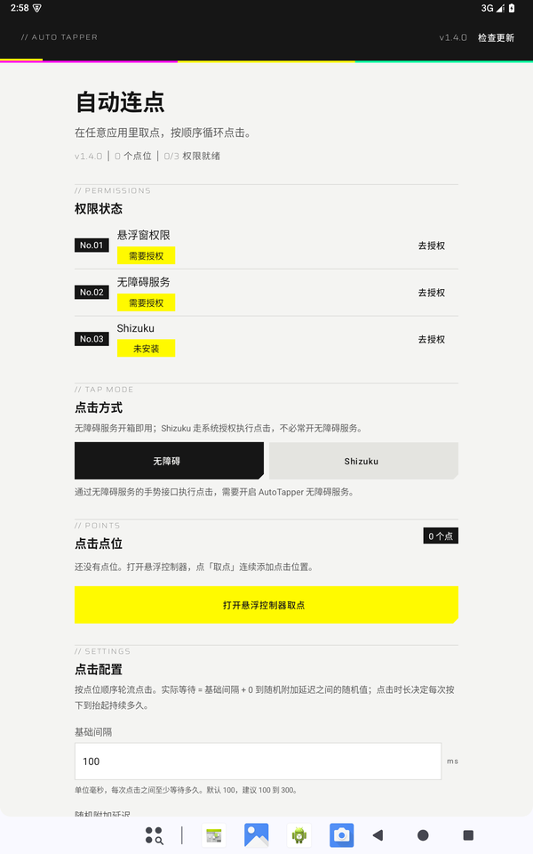
</p>

- 主界面按窗口宽度切换：**≥840dp** 起两栏（45 : 55），更窄时单列；尺寸与字号由 `w<N>dp` 资源限定符给出。
- 二级页面（规则、插件、日志、设置）在平板上把内容收窄到 **720dp 并居中**，
  避免 1600px 宽的一行只写一个规则名；手机上没有变化。

<p align="center">
  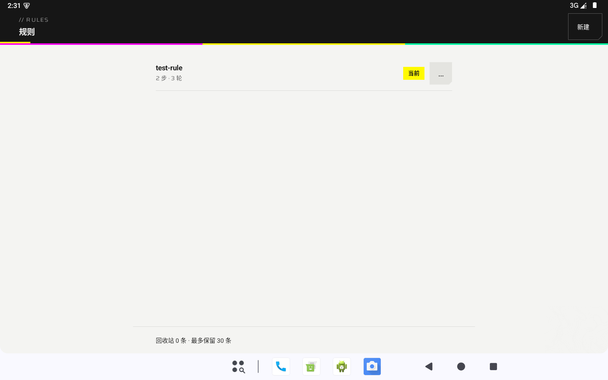
</p>
- 悬浮控制器在平板上同步放大：窄条、收起小标签、读数板、格子与点位徽标都变大。

| | 手机 | 平板竖屏 | 平板横屏 / 大屏 |
| --- | --- | --- | --- |
| 页边距 | 16dp | 40dp | 48dp |
| 主界面栏目数 | 单列 | 单列 | 左右两栏 |
| 二级页面宽度 | 铺满 | 铺满 | 收窄到 720dp 居中 |
| 按钮高度 | 48dp | 56dp | 56dp |

## 工作原理

<p align="center">
  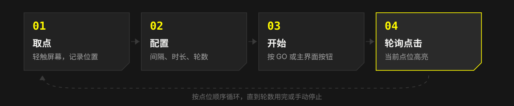
</p>

- **StepEngine**：按规则顺序执行，负责暂停/继续/停止、每步超时、日志与状态广播；
  装了 `flow-control` 插件后，每步前后的延迟、超时、重复次数与失败分支由插件决定（策略扩展点）。
- **注入通道**：`AutomationExecutor` 有两个实现——无障碍的 `dispatchGesture`，或 Shizuku 以 shell 身份拉起 `TapUserService`（AIDL）。
- **插件运行时**：`index.json`（带 ETag 缓存 + 镜像回退）→ 下载 → sha256 → 置只读 → `DexClassLoader` 装载 → 注册表。
  插件连续 3 次抛异常会被自动停用，不会把整条规则拖垮。
- **宿主能力**：截图（MediaProjection）、识字（云端 OCR）、无障碍节点树、区域存取、响铃震动、录制、校准时间、日志。

## 从源码构建

```bash
# 需要 JDK 17 与 Android SDK 34
./gradlew assembleDebug
# 产物：app/build/outputs/apk/debug/app-debug.apk

# 单元测试（纯 JVM，不需要设备）
./gradlew :app:testDebugUnitTest
```

插件仓库（`AutoTapperPlugin`）是独立的纯 JVM 工程，构建链是
`gradle build → d8 转 dex → 生成 index.json`，详见该仓库的 README。

### 关于"每次构建签名不一样"

APK 的签名算法本身是确定的，**变的是被签名的内容**：AGP 打包时会把每个 zip 条目的修改时间写成构建时间，
签名摘要因此每次都不同。仓库里带了 `tools/reproducible_apk.py`：按固定时间戳重排重打包 →
`zipalign` → 用同一把密钥重新签名，同一份源码连续构建两次可以得到 **完全相同的 sha256**。
插件 jar 与 dex jar 本身已经是可复现的（`preserveFileTimestamps = false` + `reproducibleFileOrder = true`，
实测两次构建哈希一致）。

## 已知限制

- **Shizuku 模式**需要你自己启动 Shizuku server（无线调试或 adb），应用只负责授权与调用。
- **云端识字**要把截图上传到你填的服务地址，别拿敏感界面去识字；没有令牌时识字类插件会如实失败。
- **屏幕截图**授权在进程被杀后失效，需要重新授权一次。
- **录制回放**只把点按转成基础点击；滑动没有对应的内置步骤，会如实跳过并写日志。
- 插件**没有沙箱**：它与主程序同权限，能读屏幕、能点击。只装你信任来源的插件。
- `rules` / `console-ui` / `keepalive` 三个模块保留为占位：规则管理、控制台透明度、前台保活已经在主程序里，
  不做成插件。
- 应用不做任何数据上传；`INTERNET` 权限用于更新检查、插件仓库（含镜像）与云端识字。

## 更新日志

见 [CHANGELOG.md](./CHANGELOG.md)。

## 致谢

界面字体 [Saira](https://github.com/googlefonts/saira-font)（SIL OFL 1.1，许可证随包附在 `app/src/main/assets/licenses/`）；
视觉规范参考 [endfield-ui](https://github.com/hhikr/endfield-ui-skill)。