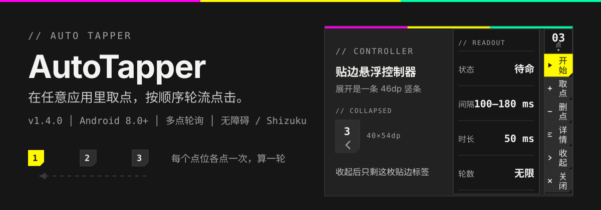
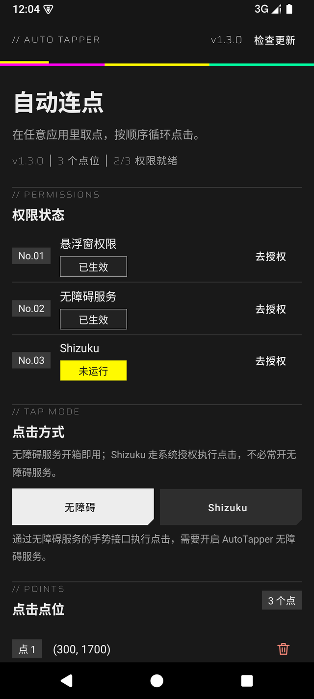

<p align="center">
  
</p>

**AutoTapper** 是一个 Android 多点连点工具：在任意应用里轻触取点，然后按顺序轮流点击。点击由 **无障碍手势** 或 **Shizuku** 执行，二选一；控制器、点位徽标和当前进度都浮在被控应用之上。

## 先看效果

<p align="center">
  
  
</p>
<p align="center">
  
  
</p>

## 它解决什么

- **多点轮询**：每个点位按顺序各点一次算一轮，当前点位用信号黄徽标标出并闪烁，轮数与间隔可调。
- **两种授权方式**：无障碍服务开箱即用；Shizuku 授权后由系统 shell 注入点击，不必常开无障碍服务。
- **控制器常驻**：收起是一枚 40×54dp 的贴边小标签，展开是一条 46dp 宽的窄条，取点、开始、停止都不离开被控应用。
- **参数可调**：基础间隔、随机附加延迟、点击时长、轮数、悬浮窗透明度，输入合法即保存。

## 怎么用

1. 到 [Releases](https://github.com/YangZiyueZY/AutoTapper/releases/latest) 下载 APK 安装（Android 8.0 / API 26 及以上）。
2. 授予**悬浮窗权限**，然后在「点击方式」里选一种并完成授权：
   - **无障碍**：点「无障碍服务」右侧的去授权，开启 AutoTapper 无障碍服务；
   - **Shizuku**：先安装并启动 [Shizuku](https://shizuku.rikka.app/)，再点「Shizuku」右侧的去授权。
3. 展开贴边小标签，按「取点」进入取点，在屏幕上轻触连续记录位置，完成后点「完成」。
4. 按「开始」运行，按「停止」停下；需要删点时按「删点」，查看当前状态按「详情」，暂时不用就按「收起」，结束服务按「关闭」。

> 授权不会让它自动点击：只有按「开始」或主界面按钮时才会执行。

## 两种点击方式

| | 无障碍 | Shizuku |
| --- | --- | --- |
| 前置条件 | 开启 AutoTapper 无障碍服务 | 安装并启动 Shizuku，授权 AutoTapper |
| 点击实现 | `dispatchGesture` 手势 | Shizuku 以 shell 身份注入触摸事件 |
| 适合 | 大多数设备，设置最少 | 已装 Shizuku；不想常开无障碍服务 |
| 注意 | 部分系统的后台手势有限制 | Shizuku 进程停止后需重新启动 |

在主界面「点击方式」一栏切换；切换时会先停止正在进行的点击，避免两套执行器同时工作。

## 参数

| 配置项 | 说明 | 默认与范围 |
| --- | --- | --- |
| 基础间隔 | 两次点击之间至少等待多久 | 100 ms，最低 100 ms |
| 随机附加延迟 | 在基础间隔上再加 0 到该值的随机等待 | 80 ms |
| 点击时长 | 每次按下到抬起持续多久 | 50 ms，10–2000 ms |
| 点击轮数 | 完整跑几轮，0 表示一直点到手动停止 | 0 |
| 悬浮窗透明度 | 控制器整体不透明度 | 100%，30%–100% |

## 悬浮控制器

控制器是一条贴着屏幕边缘的窄条：展开 46dp 宽，收起只剩 40×54dp 的小标签，尽量不压住被操作区域。

| 控件 | 作用 |
| --- | --- |
| 顶部读数格 | 当前点位数 + 运行状态灯 |
| 开始 / 停止 | 同一格切换开始与停止；待命时整格是信号黄（开始），运行中反成墨色（停止） |
| 取点 | 进入取点，轻触屏幕连续记录位置 |
| 删点 | 删除最后一个点位 |
| 详情 | 在窄条内侧展开只读读数板：状态、间隔、时长、轮数 |
| 收起 | 收回成 40×54dp 的贴边小标签，标签上仍显示点位数与展开箭头 |
| 关闭 | 结束前台服务，移除全部悬浮窗 |

- 顶部读数格可以直接上下拖动，松手后吸附到最近的屏幕边缘，位置会被记住；贴在左边时图标与箭头自动镜像。
- 闲置 4 秒后控制器淡化到设定不透明度的 45%，点一下立刻恢复；点击进行中保持在 85%，方便边点边看。
- 点位徽标是 24dp 细环加序号，当前点位填成信号黄并闪烁；收起控制器时徽标隐藏，只有点击进行中才保留在屏幕上。
- 读数板是只读的，点它会穿透到下面的应用；取点时控制器先淡出，取完自动回来；收起控制器时读数板跟窄条一起淡出，不会留在屏幕上。

## 平板适配

布局按 Android 窗口尺寸自动切换：**sw600dp 起算平板**，可用宽度 **≥840dp**（平板横屏、大屏）起两栏。

- 手机：保持原来的单列。
- 平板竖屏：仍是单列，但内容加宽并居中，页边距放大，看着不挤。
- 平板横屏 / 大屏：改成左右两栏——左边放说明、权限状态与点击方式，右边放点位列表、参数与当前配置、说明；栏间距 40dp。
- 平板上的按钮、输入框、列表行高和字号同步放大，大标题、分区标题和正文都更醒目。
- 悬浮控制器在平板上也跟着放大：窄条、收起小标签、读数板、格子与点位徽标都变大，贴边距与切角细节保持同样的视觉语言。

三档主要尺寸对照：

| | 手机 | 平板 | 大屏（横屏 / 宽屏） |
| --- | --- | --- | --- |
| 页边距 | 16dp | 32dp | 40dp |
| 内容上限 | 不限 | 640dp | 1120dp |
| 栏目数 | 单列 | 单列居中 | 左右两栏 |
| 按钮高度 | 48dp | 56dp | 56dp |
| 窄条宽度 | 46dp | 54dp | 58dp |
| 徽标直径 | 24dp | 28dp | 30dp |

## 工作原理

<p align="center">
  
</p>

点击循环集中在 `TapEngine`，两种执行方式共用同一套点位顺序、间隔、轮数与状态广播：

- **无障碍**：`AccessibilityService.dispatchGesture` 在点位上发送点击手势；
- **Shizuku**：Shizuku 以 shell 身份拉起 `TapUserService`（AIDL），由它注入触摸事件；注入不可用时回退到 `input` 命令。

## 从源码构建

```bash
# 需要 JDK 17 与 Android SDK 34
./gradlew assembleDebug
# 产物：app/build/outputs/apk/debug/app-debug.apk
```

推送到 `main` 时，GitHub Actions 会自动构建 Debug APK 并发布到 Release。

## 已知限制

- 不支持滑动与复杂动作编排。
- Shizuku 模式需要你自己启动 Shizuku server（无线调试或 adb），应用只负责授权与调用。
- 应用不做任何数据上传，`INTERNET` 权限只用于检查 GitHub 上的新版本。

## 更新日志

见 [CHANGELOG.md](./CHANGELOG.md)。

## 致谢

界面字体 [Saira](https://github.com/googlefonts/saira-font)（SIL OFL 1.1，许可证随包附在 `app/src/main/assets/licenses/`）；视觉规范参考 [endfield-ui](https://github.com/hhikr/endfield-ui-skill)。
